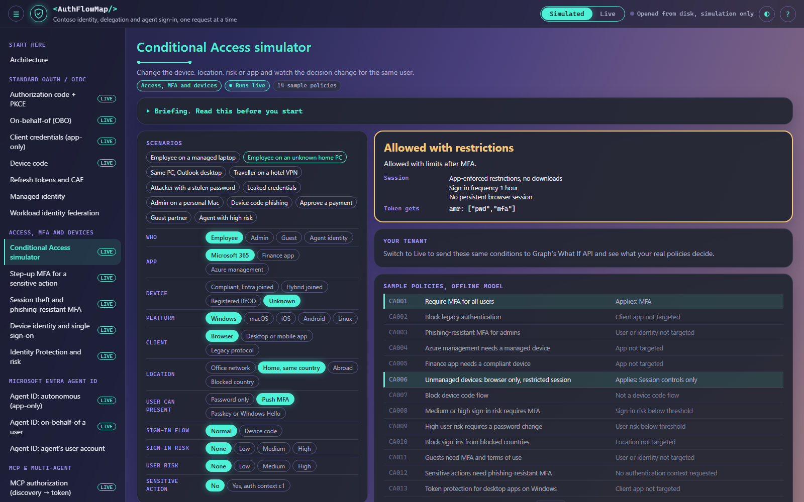
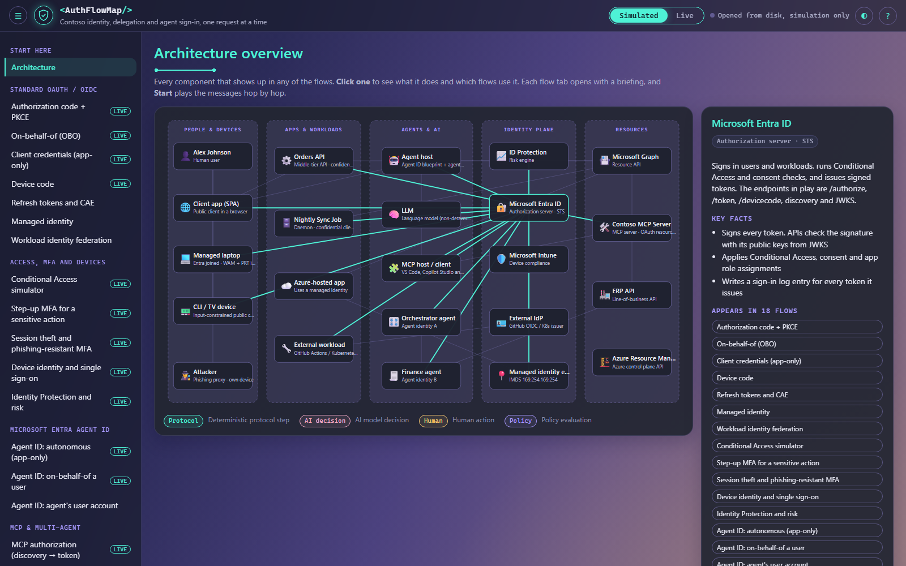

# AuthFlowMap

An interactive map of how modern authentication actually works, one HTTP request at a time. It covers standard OAuth 2.0 and OIDC, Conditional Access, MFA, devices and risk, Microsoft Entra Agent ID, MCP authorization under the 2025-11-25 spec, chains of agents calling each other, and how Work IQ and Foundry IQ keep an agent's answers limited to what the asking user may see.

I built it to explain these flows to a room without hand-waving. Every step shows who sends what to whom, what the token contains, what gets checked and who made the decision.


## Quick start

Open `demonstrator/index.html` in Edge or Chrome. It's a single file with no dependencies and no network calls, so it also works offline.

## How to read the screen

**The side menu** groups the tabs. Start with Architecture, then pick a flow. A LIVE badge means the tab can also run against a real tenant. A PREVIEW badge means the tab relies on features Microsoft still lists as preview.

**The briefing** at the top of each flow tab says what the flow is for, what has to be set up and the anti-pattern it prevents, and links to the documentation behind it. Read it before pressing Start. It folds away once the flow runs.

**The controls** play, pause and step through the flow. Components shows the hops on an architecture diagram. Sequence shows the same messages as a sequence diagram. Some tabs have variants, such as a managed versus an unknown device, that change the steps.

**The diagram** highlights one hop at a time.

- The component glowing mint and marked SENDING is the sender.
- The component glowing rose and marked RECEIVING is the receiver.
- A component with a dashed, moving border and PROCESSING is working on its own, for example validating a token.
- The small pill travelling along the arrow is the message. Its label names the token or HTTP method it carries.
- Violet arrows are hops that already happened. Dashed grey arrows are hops still to come.

**The badge on every step** says who decided it.

| Badge | Meaning |
|---|---|
| Protocol | Fixed protocol logic. The same input always gives the same output |
| AI decision | The language model chose this, so another run might differ. Access never depends on it |
| Human | A person signed in, approved something or typed a code |
| Policy | Entra applied configuration, such as Conditional Access, consent or app roles |

**The inspector** on the right has five tabs. Keys 1 to 5 switch between them.

- **Overview** explains the step in plain words, and why it matters.
- **Request** and **Response** show the raw HTTP, with secrets and token signatures masked.
- **Tokens** decodes every JWT in the step. Highlighted rows are the claims worth pointing at, and each claim has a one-line explanation.
- **Checks** lists what the receiver verified, with a tick or a cross.

**The step list** under the diagram shows every step. Click any step to jump to it.

**The Conditional Access simulator** works differently. Pick a scenario or flip the switches on the left, and the right side shows the decision, what the user experiences, which sample policies applied and what ends up in the token.



**The Reference tab** has tables for grant types, delegation models, consent, authentication methods, device states, Conditional Access, hybrid identity, external identities, governance, agent identities, MCP, the IQ products, oversharing controls, token claims, anti-patterns and common errors. The filter box searches all of them. The first table, also in the side menu as Documentation links, collects every public document the tabs are based on: Microsoft Learn, the MCP specification and the IETF RFCs.

**The IQ and grounded agents tabs** follow one question: whose identity reaches the data? Work IQ over MCP shows the four layers that decide each tool call: Entra sign-in, the delegated `WorkIQAgent.Ask` permission, the user's Microsoft 365 permissions and the tenant policy that blocks writes by default. Foundry IQ knowledge base shows a retrieve call that carries two identities, the agent's managed identity and the user's token, and Azure AI Search trimming results to the user's ACLs. Foundry IQ + Work IQ shows Azure AI Search running OBO through a federated credential so Microsoft 365 is still read as the user. Oversharing runs the same salary question three ways, and only one of them keeps the file away from a contractor. These four tabs are simulated only.

Keyboard: Space starts and pauses, the arrow keys step, R resets, V switches the view, N hides the side menu and ? shows help.



## Two modes

**Simulated** is the default and needs nothing. The requests look real and the tokens decode like real JWTs, but they're fake and unsigned, built from a fictitious Contoso tenant. The PKCE challenge is a real SHA-256 of the verifier.

**Live** runs the same tabs against an Entra test tenant you own. A local Node server does the confidential-client work: OBO, client credentials, device code, the Agent ID exchanges and a small MCP server. The browser does the auth code + PKCE sign-in in a popup and plays the MCP client. Every request is recorded as it happens and replayed at a speed you can talk over. Steps tagged REAL are real traffic. Steps tagged SIM are the language model steps, since the demo server has no model.

Fourteen tabs run live, including the confidential web app, where the local server plays the web app back end and redeems the code with its own secret or certificate. Refresh and CAE, managed identity, workload identity federation, the agent's user account, the multi-agent chain and the IQ tabs stay simulated. The IQ tabs would need Microsoft 365 Copilot licenses, Work IQ billing and an Azure AI Search service, which is more than a demo tenant should carry. The access, MFA and devices tabs go live in their own way, because nobody wants a real phishing attack in a meeting.

- **Conditional Access simulator.** The same switches go to Graph's What If API, and your tenant's real policies answer.
- **Step-up MFA.** The API really returns a claims challenge, you really step up, and the retry succeeds with `acrs` in the token. Needs `-EnableStepUpPolicy` at provisioning.
- **Session theft.** Signs you in, shows the `amr` in your real token, lists your registered methods and marks which ones resist phishing.
- **Device identity.** Signs you in from this browser and shows whether the token carries a `deviceid`. Try it from a managed Windows laptop in Edge, then from a personal browser.
- **Identity Protection.** Reads your tenant's latest risk detections and risky users.

Conditional Access, What If and step-up need Entra ID P1. Risk data needs P2.

## Setting up Live mode

You need PowerShell 7, Node 20 or later and a test tenant where you're allowed to create app registrations and grant admin consent.

```powershell
# 1. Provision the test tenant. Creates the apps, the Agent ID blueprint, one agent identity and all grants, then writes .env
pwsh ./provisioning/New-AuthFlowTenant.ps1 -TenantId <tenant-guid>
#    add -SkipAgentId if Agent ID isn't enabled in the tenant, or -SkipCertificate to skip the daemon cert
#    add -EnableStepUpPolicy for the live step-up tab. It creates authentication context c1 and a policy
#    scoped to the demo user only. -DemoUserUpn picks the demo user, otherwise it's you

# 2. Start the local server. It binds to 127.0.0.1 only
cd server
npm install
npm start

# 3. Open http://localhost:5100 and flip the switch in the top right to Live
```

New permissions take 30 to 120 seconds to reach the token service. If the first live run fails with a consent error, wait a minute and try again. To remove everything, run `pwsh ./provisioning/Remove-AuthFlowTenant.ps1 -TenantId <tenant-guid>`.

To skip the script, copy `.env.example` to `.env` at the repo root and fill it in yourself. Register the SPA redirect URI `http://localhost:5100/auth-callback` under the SPA platform and turn on public client flows.

### Safety

Use a test tenant. The API, MCP server and blueprint authenticate with client secrets here because a laptop has no managed identity. Each tab says what production should use instead.

Secrets live in `.env` and the server process, and `.env` is gitignored. The browser never gets them. On screen, tokens show a short prefix of the header and payload and the signature is always cut. The decoded claims show in full, because that's the part worth explaining.

The server rejects any Host header that isn't loopback, rejects cross-origin POSTs and sends no CORS headers.

## Making it your own

To rebrand the simulated tenant, change the names and IDs in the `ID` block of `demonstrator/src/config.js`. The colours sit at the top of `demonstrator/src/styles.css`. The page defaults to dark. Add `?theme=light` to the URL, or use the ◐ button, for the light version.

After changing anything in `demonstrator/src`, rebuild the single file with `npm run build`. `npm test` runs the server tests, and `node demonstrator/check-links.mjs` checks every documentation link. A link fails if it returns an error, redirects anywhere, or serves a "page not found" page, so a moved page shows up before a customer clicks it.

```
demonstrator/
  src/                 # styles, flow definitions, reference tables, engine, live client
  build.mjs            # inlines src/* into a single index.html
  index.html           # the built file you open
server/                # Express + jose backend: raw /token calls, trace store, MCP server
provisioning/          # New-AuthFlowTenant.ps1 and Remove-AuthFlowTenant.ps1, both via Microsoft Graph
docs/                  # screenshots
```

## Accuracy

The Agent ID steps (`fmi_path`, agent OBO, `user_fic`) and the `xms_*` claims follow three public Microsoft Learn pages: "Agent OAuth flows: On-behalf-of flow", "Agent's user account impersonation protocol" and "Token claims reference for agent IDs". Agent ID still changes often, so reread them before you rely on a detail.

Entra doesn't support Client ID Metadata Documents or Dynamic Client Registration, so the MCP flows use a pre-registered client. In Live mode the MCP authorization tab also checks whether your tenant's discovery document lists `code_challenge_methods_supported`. The spec tells clients to refuse to continue when that field is missing.

The Conditional Access simulator's offline engine is a teaching model of a sample policy set. It isn't Entra's evaluation logic. For real answers, use Live mode, which asks Graph's What If API.

The IQ tabs follow the Work IQ MCP, Work IQ permissions and policy governance pages, "Connect agents to Foundry IQ knowledge bases", "Query-time ACL and RBAC enforcement", "Query a knowledge base" and "Create a Work IQ knowledge source". Most of what they show is preview, API version `2026-08-01-preview` at the time of writing. Two Learn pages disagree on what a permission-enabled index returns when the user token is missing, so the tab tells you to always send it rather than picking a side. The Work IQ policy-denied error body is illustrative.

## Disclaimer

This is an independent educational project. It isn't affiliated with or endorsed by Microsoft. Contoso and every user, app and ID in Simulated mode are fictitious. Microsoft, Entra and related names are trademarks of their owners.
