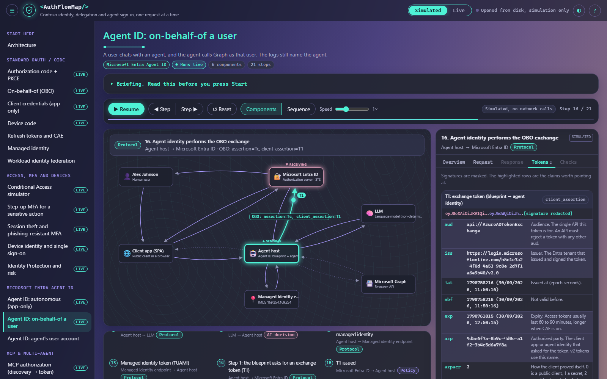

# AuthFlowMap

An interactive map of how modern authentication works, one request at a time. It walks through OAuth 2.0 and OIDC, Conditional Access, Microsoft Entra Agent ID, MCP authorization, Work IQ and Foundry IQ, and Global Secure Access with Zero Trust. Each step shows who sends what to whom, what the token contains and who made the decision.

The on-premises perspective covers AD-backed cloud sign-in with PHS, PTA and AD FS, AD-only versus hybrid-joined devices, and Application Proxy bridging cloud MFA to Kerberos. These simulations show which boundary enforces each decision, including direct intranet paths that never invoke cloud Conditional Access.



## Getting started

Open `demonstrator/index.html` in Edge or Chrome. It's a single file with no dependencies and no network calls, so it works offline. Start on the Architecture page, pick a flow, read the briefing and press Start. Press `?` in the page for the keyboard shortcuts.

### Live mode (optional)

Live mode runs many of the flows against an Entra test tenant you own. It needs PowerShell 7, Node 20 or later, and rights to create app registrations and grant admin consent.

```powershell
pwsh ./provisioning/New-AuthFlowTenant.ps1 -TenantId <tenant-guid>   # creates the apps and writes .env
cd server; npm install; npm start                                      # local server on 127.0.0.1
# open http://localhost:5100 and switch to Live in the top right
```

Use a test tenant. `pwsh ./provisioning/Remove-AuthFlowTenant.ps1 -TenantId <tenant-guid>` removes everything again.

### Development

Edit the files in `demonstrator/src`, then run `npm run build` to rebuild `index.html`. Run `npm install` and `npx playwright install chromium` once, then `npm run test:all` for the server tests, the build check and the UI suite. What changed between versions is in the [changelog](CHANGELOG.md).

## License

[MIT](LICENSE) © Jinssi

This is an independent educational project. It isn't affiliated with or endorsed by Microsoft. Contoso and every user, app and ID in Simulated mode are fictitious. Microsoft, Entra and related names are trademarks of their owners.
